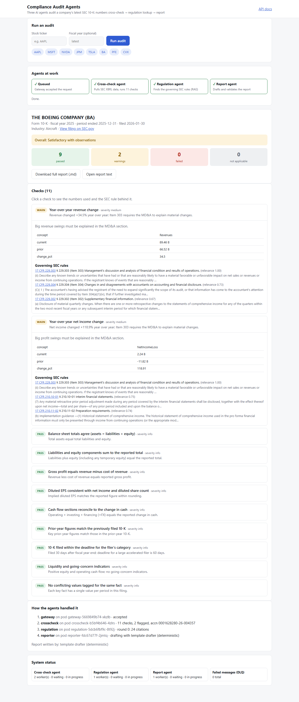
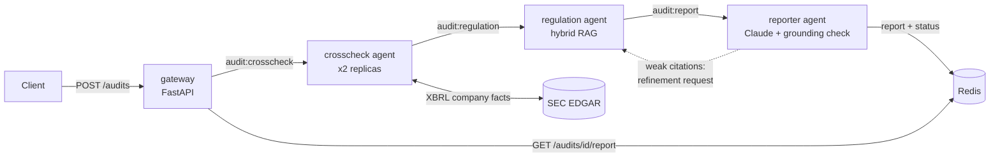

# Compliance Audit Agents

A multi-agent system that audits public companies' SEC filings. Three specialised agents (a numbers
cross-checker, a regulation retriever (RAG), and a report drafter) coordinate through Redis Streams. Each one is
packaged as its own container and deployed as its own Kubernetes Deployment.

All of the data is real and fetched live:

- **Financials:** the company's 10-K numbers from the [SEC EDGAR XBRL API](https://www.sec.gov/edgar/sec-api-documentation)
- **Regulations:** 248 sections of Title 17 CFR scraped from the [eCFR API](https://www.ecfr.gov/developers/documentation/api/v1)
  (Regulation S-X, Regulation S-K, Regulation G, Regulation S-T Rule 405, and Exchange Act reporting rules)

Open **http://localhost:8080** (or :8000 locally): type a ticker, watch the three agents hand the job to each other live, then explore every check with its numbers and the SEC rule behind it. Links like `/?ticker=AAPL` start an audit, and `/?job=<id>` reopens a finished one.



## Architecture



| Agent | Role | Key techniques |
|---|---|---|
| **crosscheck** | Pulls the company's XBRL facts from EDGAR and runs 11 accounting checks: balance-sheet identity, liabilities + equity components, gross profit, diluted EPS (net of preferred dividends), cash-flow reconciliation (incl. FX), year-over-year swings (Item 303 MD&A triggers), restatement detection against the prior-year 10-K (stock splits are recognised and excluded), filing deadline by filer category (from public float), liquidity / going-concern indicators, and conflicting XBRL facts | Picks the right filing and period from raw XBRL, handles tag variants, keeps a Redis cache, throttles under SEC's rate limit |
| **regulation** | Attaches the governing regulations to every finding | BM25 + `bge-small-en-v1.5` dense embeddings fused with reciprocal-rank fusion; resolves explicit references ("Item 303", "Rule 12b-25"); **industry scoping**: bank/insurance/oil & gas/mining articles are used only for companies in that industry (from their SEC SIC code), and deal-specific rules (roll-ups, SPACs, ABS) are excluded |
| **reporter** | Drafts the audit report | Claude (`claude-opus-5-5`) writes the narrative; a **grounding validator** rejects any draft that cites a CFR section the regulation agent didn't retrieve or states a dollar figure that isn't in the evidence, and falls back to a deterministic template. If a flagged finding has weak citations, the reporter **sends it back to the regulation agent** for a refinement round |
| **gateway** | Web UI and HTTP API: submit audits, watch the agents live, browse results, inspect queue depth | FastAPI, input validation, dependency-free single-page UI |

### Messaging guarantees (Redis Streams)

- One stream and one consumer group per agent role. Pods of the same role share the work, so `kubectl scale` is all it takes.
- A message is acked only after its handler succeeds. Messages left behind by crashed pods are reclaimed with `XAUTOCLAIM`, and after 3 failed deliveries they go to `audit:dlq`.
- Permanent errors (unknown ticker, fiscal year with no 10-K) fail fast without retries.
- Job status updates run as atomic transactions, and a terminal state (`completed`/`failed`) can never be overwritten by a slower agent's late update.

## Run it

### Local processes (no Docker)

```powershell
python -m venv .venv; .venv\Scripts\python -m pip install -r requirements/dev.txt
python -m agents.regulation.retriever              # build the RAG index (downloads the embedding model once)
redis-server                                       # any Redis >= 6.2
.\scripts\run_local.ps1                            # 2x crosscheck, regulation, reporter, gateway
python scripts/run_e2e.py --url http://127.0.0.1:8000 AAPL MSFT JPM
```

### Docker Compose

```bash
docker compose up --build -d
python scripts/run_e2e.py --url http://localhost:8000
```

### Kubernetes (kind)

```bash
./scripts/deploy_kind.sh            # or .\scripts\deploy_kind.ps1 on Windows
python scripts/run_e2e.py --url http://localhost:8080
kubectl -n compliance-audit scale deploy/crosscheck --replicas=4
```

Manifests are in [`k8s/`](k8s/). Each agent is its own Deployment with liveness probes, resource limits, a non-root
read-only filesystem and dropped capabilities. Redis runs as a StatefulSet with AOF persistence.

### Configuration

| Variable | Default | Notes |
|---|---|---|
| `SEC_USER_AGENT` | `ComplianceAuditAgents research-project contact@example.com` | **Set to your own name and email.** SEC requires automated clients to identify themselves |
| `ANTHROPIC_API_KEY` | unset | If set, the reporter drafts with Claude. In k8s, put it in the optional `anthropic` secret |
| `LLM_MODE` | `auto` | `auto` / `template` / `claude` |
| `ANTHROPIC_MODEL` | `claude-opus-5-5` | |

### API

```bash
curl -X POST localhost:8000/audits -H 'content-type: application/json' -d '{"ticker":"BA","fiscal_year":2025}'
curl localhost:8000/audits/<job_id>            # status + summary
curl localhost:8000/audits/<job_id>/report     # markdown report
curl localhost:8000/audits/<job_id>/result     # full evidence: findings, values, citations, agent trace
curl localhost:8000/queues                     # per-agent lag / pending / consumers, DLQ depth
```

## Testing

```bash
python -m pytest -q                                      # 87 unit + integration tests
python scripts/run_e2e.py --repeats 3                    # live end-to-end regression
python scripts/resilience_test.py --stop ... --start ... # agent-outage drill
```

- **Unit tests** cover each check against synthetic XBRL (including regressions found on real filings: tag
  variants, future-dated facts, stock splits, preferred dividends), retrieval quality on the real eCFR corpus
  (known queries must hit the governing section; scoping rules), the grounding validator, and the Claude request
  shape (using a fake client).
- **Pipeline tests** run all four agents against an in-memory Redis: the full flow, the refinement loop, retries
  and the DLQ, fail-fast errors, and the terminal-status race.
- **End-to-end** (`scripts/run_e2e.py`) runs real tickers through the live system several times and checks that
  every job completes through all agents, every report has every section, every flagged finding has a citation,
  every citation in a report was actually retrieved, repeated runs give identical results, and bad inputs are rejected.
- **CI** ([`.github/workflows/ci.yml`](.github/workflows/ci.yml)) runs the unit tests, builds all four images,
  deploys them to a kind cluster and runs the end-to-end suite against it. SEC rejects automated requests from
  GitHub Actions IP ranges (HTTP 403), so CI seeds the agents' SEC cache with a recorded snapshot of real SEC data
  ([`scripts/sec_snapshot.py`](scripts/sec_snapshot.py), trimmed to the concepts the checks use and verified to
  give identical results). Runs from a normal network use live SEC data.

Sample reports from the end-to-end runs are in [`docs/sample-reports/`](docs/sample-reports/).

## Project layout

```
agents/crosscheck/   SEC client, 11 accounting checks, agent loop, Dockerfile
agents/regulation/   hybrid retriever, agent loop, Dockerfile (index baked into the image)
agents/reporter/     Claude + template drafters, grounding validator, refinement loop, Dockerfile
agents/gateway/      FastAPI service, Dockerfile
common/              message schemas, Redis Streams worker, config
scraper/             eCFR regulation scraper -> data/regulations.jsonl
k8s/                 namespace, config, Redis StatefulSet, one Deployment per agent, kind config
scripts/             local runner, kind deploy, e2e regression, resilience drill
tests/               pytest suite
```

## Limitations

These are automated consistency and disclosure-trigger checks on XBRL-tagged data. They are **not** an audit
opinion, they don't evaluate internal control over financial reporting, and they don't read the MD&A narrative.
Checks are marked N/A when a filer doesn't tag the concepts they need (for example, banks don't report gross profit).
