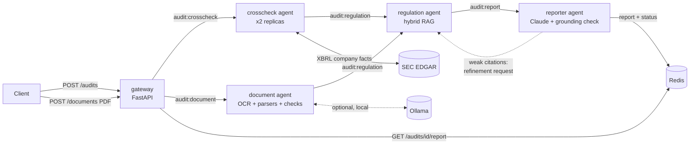

# Compliance Audit Agents

A multi-agent system that audits public companies' SEC filings, and long PDF document bundles that have no
ticker (Indian income-tax / GST evidence bundles of a few hundred pages). Specialised agents (a numbers
cross-checker, a document reader, a regulation retriever (RAG), and a report drafter) coordinate through Redis
Streams. Each one is packaged as its own container and deployed as its own Kubernetes Deployment.

All of the data is real and fetched live:

- **Financials:** the company's 10-K numbers from the [SEC EDGAR XBRL API](https://www.sec.gov/edgar/sec-api-documentation)
- **Regulations:** 248 sections of Title 17 CFR scraped from the [eCFR API](https://www.ecfr.gov/developers/documentation/api/v1)
  (Regulation S-X, Regulation S-K, Regulation G, Regulation S-T Rule 405, and Exchange Act reporting rules)
- **Indian tax law** (for document audits): the Ministry of Finance's memoranda explaining every Finance Bill
  2016–2024 and the enacted text of s.194N, from [indiabudget.gov.in](https://www.indiabudget.gov.in), and the
  CGST Act, 2017 from the [India Code](https://indiacode.gov.in) API (scraper: `scraper/scrape_india_tax.py`)

Open **http://localhost:8080** (or :8000 locally): type a ticker, watch the three agents hand the job to each other live, then explore every check with its numbers and the SEC rule behind it. Links like `/?ticker=AAPL` start an audit, and `/?job=<id>` reopens a finished one.


## Auditing a PDF (no ticker)

Upload a PDF in the **Audit a document** panel (or `POST /documents`). The document agent reads every page, and
OCRs the scanned ones. It recognises the parts of the bundle (ITR acknowledgement and form, AIS/TIS, GSTR-1/3B,
tax invoices, bank statements, s.194N certificates, assessment orders, the written submission) and extracts their
figures. **Every figure keeps the page it came from**: the PDF page and the bundle's own printed page number.

It then runs 15 checks:

- **Turnover reconciliations.** AIS vs return turnover, and GST vs return turnover. For the GST check, invoices
  are re-bucketed by service month to tell a timing difference from a real gap.
- **GST consistency.** GSTR-1 vs GSTR-3B, and invoices vs GSTR-1.
- **Interest and TDS.** Interest in the AIS that is missing from the return, with its tax effect after s.80TTA
  and s.87A. TDS credit vs the AIS, and the head of income it was claimed under.
- **Presumptive scheme and audit.** s.44AD eligibility: the rate, the turnover limit, and the s.44AD(6)
  commission exclusion. s.44AB audit thresholds.
- **Tax and filing.** Recomputation of the tax and the rebate. Late filing and the s.234F fee.
- **Cash withdrawals.** s.194N withdrawals vs the monthly WLATMO certificates, month by month.
- **Bank statement.** Integrity against its own summary. Third-party credits and cash deposits (s.68).
- **The written submission.** Does it actually explain each discrepancy found?

The regulation agent cites only the statutory sections each check names, and the report lists the source pages
beside every number.

**Case-aware review.** A remand or appeal bundle exists because of a dispute, so the agent reads the case papers too:

- It classifies the bundle (remand, appeal, show-cause, reassessment, scrutiny). It reads the officer's notice, and
  checks that **everything the notice called for was furnished**.
- It parses assessment orders (ITBA layout) into their additions, with amount, section and description. For the
  order under dispute, it **reconciles every figure the officer used** against the documents, and flags double
  counting, such as receipts already offered being added again as bank credits. If the order isn't in the bundle,
  the report says so instead of guessing.
- It extracts the **claims in the written submission** and grades each one as supported, asserted only or
  contradicted. Examples: a medical exigency as the Rule 46A cause, "accounts used exclusively for the business",
  receipts described as commission while claiming s.44AD.
- Cross-document rules:
  - certificate coverage per bank account and month;
  - bank credits classified before s.68 (reversals and provisional credits, self transfers, possible relatives,
    businesses, cash);
  - Chapter VI-A evidence by payment date;
  - evidence dated after the year;
  - consistency with the orders of other years.
- Every finding carries the **amount involved**, and whether it **weakens or supports** the taxpayer. Severity is
  sized by the money at stake, and the report opens with a case summary ranked by severity and amount.

**Evaluation.** `scripts/eval_documents.py` scores the agent against expert-expected findings:

- **Issue recall:** the expected findings it raised.
- **Precision:** how many of its flags are expected or acceptable.
- **Figure accuracy:** extracted facts against their expected values.

| Case | Pages | Issue recall | Precision | Figure accuracy |
|---|---|---|---|---|
| Synthetic remand bundle (`tests/eval/synthetic.json`, runs in CI) | 56 | 100% | 100% | 100% |
| Real remand bundle, AY 2023-24 (private, not in the repo) | 354 | 100% (14/14) | 100% | 100% (9/9) |

The real case's expected list was written by the developer after building the checks. It shows what the agent can
reach, not an independent score. Six expert points need documents outside that bundle (the order under dispute
and its figures), and are listed separately rather than counted. More cases with independently written
expectations are the next step.

**Confidential documents stay local by default:**

- The PDF lives in Redis only until it has been read, and expires after an hour regardless. It is never written
  to disk or logs, and `data/private/` is excluded from git and Docker builds.
- The AI reader is switchable per document:
  - `local` (default): [Ollama](https://ollama.com) on your machine (`ollama pull qwen2.5:3b`), so nothing leaves it.
  - `none`: rules only, no AI model.
  - `claude`: the Claude API, used only when the uploader picks it.
- Every figure or quote the AI reader returns must appear on its page, or it is discarded.
- Unless the uploader chose Claude, the report is written by the local template drafter.

A 350-page bundle takes about 5 minutes with rules only, and about 15 minutes with the local AI reader, on a
laptop CPU (OCR of scanned pages dominates).

## Architecture



| Agent | Role | Key techniques |
|---|---|---|
| **crosscheck** | Pulls the company's XBRL facts from EDGAR and runs 11 accounting checks: balance-sheet identity, liabilities + equity components, gross profit, diluted EPS (net of preferred dividends), cash-flow reconciliation (incl. FX), year-over-year swings (Item 303 MD&A triggers), restatement detection against the prior-year 10-K (stock splits are recognised and excluded), filing deadline by filer category (from public float), liquidity / going-concern indicators, and conflicting XBRL facts | Picks the right filing and period from raw XBRL, handles tag variants, keeps a Redis cache, throttles under SEC's rate limit |
| **document** | Reads an uploaded PDF and runs 15 income-tax / GST checks with page provenance | pypdf text layer, RapidOCR for scanned pages, content-based page classification, deterministic parsers, switchable grounded AI reader (Ollama / Claude / off), narrative-coverage check; `bus.keepalive()` keeps long jobs from being reclaimed |
| **regulation** | Attaches the governing regulations to every finding | BM25 + `bge-small-en-v1.5` dense embeddings fused with reciprocal-rank fusion; resolves explicit references ("Item 303", "Rule 12b-25"); **industry scoping**: bank/insurance/oil & gas/mining articles are used only for companies in that industry (from their SEC SIC code), and deal-specific rules (roll-ups, SPACs, ABS) are excluded |
| **reporter** | Drafts the audit report | Claude (`claude-opus-5-5`) writes the narrative; a **grounding validator** rejects any draft that cites a CFR section the regulation agent didn't retrieve or states a dollar figure that isn't in the evidence, and falls back to a deterministic template. If a flagged finding has weak citations, the reporter **sends it back to the regulation agent** for a refinement round |
| **gateway** | Web UI and HTTP API: submit audits, watch the agents live, browse results, inspect queue depth | FastAPI, input validation, dependency-free single-page UI |

### Messaging guarantees (Redis Streams)

- One stream and one consumer group per agent role. Pods of the same role share the work, so `kubectl scale` is all it takes.
- A message is acked only after its handler succeeds. Messages left behind by crashed pods are reclaimed with `XAUTOCLAIM`, and after 3 failed deliveries they go to `audit:dlq`.
- Permanent errors (unknown ticker, fiscal year with no 10-K) fail fast without retries.
- Job status updates run as atomic transactions, and a terminal state (`completed`/`failed`) can never be overwritten by a slower agent's late update.

## Run it

### Local processes (no Docker)

```powershell
python -m venv .venv; .venv\Scripts\python -m pip install -r requirements/dev.txt
python -m agents.regulation.retriever              # build the RAG index (downloads the embedding model once)
redis-server                                       # any Redis >= 6.2
.\scripts\run_local.ps1                            # 2x crosscheck, regulation, reporter, gateway
python scripts/run_e2e.py --url http://127.0.0.1:8000 AAPL MSFT JPM
```

### Docker Compose

```bash
docker compose up --build -d
python scripts/run_e2e.py --url http://localhost:8000
```

### Kubernetes (kind)

```bash
./scripts/deploy_kind.sh            # or .\scripts\deploy_kind.ps1 on Windows
python scripts/run_e2e.py --url http://localhost:8080
kubectl -n compliance-audit scale deploy/crosscheck --replicas=4
```

Manifests are in [`k8s/`](k8s/). Each agent is its own Deployment with liveness probes, resource limits, a non-root
read-only filesystem and dropped capabilities. Redis runs as a StatefulSet with AOF persistence.

### Configuration

| Variable | Default | Notes |
|---|---|---|
| `SEC_USER_AGENT` | `ComplianceAuditAgents research-project contact@example.com` | **Set to your own name and email.** SEC requires automated clients to identify themselves |
| `ANTHROPIC_API_KEY` | unset | If set, the reporter drafts with Claude. In k8s, put it in the optional `anthropic` secret |
| `LLM_MODE` | `auto` | `auto` / `template` / `claude` |
| `OLLAMA_URL` / `OLLAMA_MODEL` | `http://localhost:11434` / `qwen2.5:3b` | Local AI reader for documents. In Docker/kind, start Ollama with `OLLAMA_HOST=0.0.0.0` so containers reach it at `host.docker.internal` |
| `MAX_UPLOAD_MB` | `64` | Largest PDF accepted |
| `DOC_LLM_MAX_PAGES` | `40` | Pages the AI reader reads for figures no parser covers |
| `ANTHROPIC_MODEL` | `claude-opus-5-5` | |

### API

```bash
curl -X POST localhost:8000/audits -H 'content-type: application/json' -d '{"ticker":"BA","fiscal_year":2025}'
curl localhost:8000/audits/<job_id>            # status + summary
curl localhost:8000/audits/<job_id>/report     # markdown report
curl localhost:8000/audits/<job_id>/result     # full evidence: findings, values, citations, agent trace
curl localhost:8000/queues                     # per-agent lag / pending / consumers, DLQ depth
curl -F file=@bundle.pdf -F ai_reader=local localhost:8000/documents   # audit a PDF (local | none | claude)
```

## Testing

```bash
python -m pytest -q                                      # 140 unit + integration tests
python scripts/run_e2e.py --repeats 3                    # live end-to-end regression
python scripts/run_doc_e2e.py --url http://localhost:8080 # document audit end to end (synthetic bundle)
python scripts/eval_documents.py tests/eval/*.json        # recall / precision / figure accuracy
python scripts/resilience_test.py --stop ... --start ... # agent-outage drill
```

- **Unit tests** cover each check against synthetic XBRL (including regressions found on real filings: tag
  variants, future-dated facts, stock splits, preferred dividends), retrieval quality on the real eCFR corpus
  (known queries must hit the governing section; scoping rules), the grounding validator, and the Claude request
  shape (using a fake client).
- **Document tests** use synthetic bundles in the real layouts (an invented taxpayer, never real data). They
  cover classification, every parser (including regressions found on a real 354-page bundle: AIS sections
  continuing on later pages, bank value dates glued to reference numbers, truncated balances), every check, and
  narrative coverage. They also cover AI-reader grounding (invented numbers and quotes are rejected), the upload
  -> document -> regulation -> reporter pipeline, upload validation, expired uploads, keepalive, and the rule
  that confidential documents never reach the cloud drafter. Real bundles can be tested locally: put them in
  `data/private/` with an `expected.json`; that test is skipped elsewhere.
- **Pipeline tests** run all four agents against an in-memory Redis: the full flow, the refinement loop, retries
  and the DLQ, fail-fast errors, and the terminal-status race.
- **End-to-end** (`scripts/run_e2e.py`) runs real tickers through the live system several times and checks that
  every job completes through all agents, every report has every section, every flagged finding has a citation,
  every citation in a report was actually retrieved, repeated runs give identical results, and bad inputs are rejected.
- **CI** ([`.github/workflows/ci.yml`](.github/workflows/ci.yml)) runs the unit tests, builds all four images,
  deploys them to a kind cluster and runs the end-to-end suite against it. SEC rejects automated requests from
  GitHub Actions IP ranges (HTTP 403), so CI seeds the agents' SEC cache with a recorded snapshot of real SEC data
  ([`scripts/sec_snapshot.py`](scripts/sec_snapshot.py), trimmed to the concepts the checks use and verified to
  give identical results). Runs from a normal network use live SEC data.

Sample reports from the end-to-end runs are in [`docs/sample-reports/`](docs/sample-reports/).

## Project layout

```
agents/crosscheck/   SEC client, 11 accounting checks, agent loop, Dockerfile
agents/regulation/   hybrid retriever, agent loop, Dockerfile (index baked into the image)
agents/reporter/     Claude + template drafters, grounding validator, refinement loop, Dockerfile
agents/document/     PDF text + OCR, page classifier, parsers (returns and case papers), 15 return checks,
                     7 case checks, materiality, AI reader, narrative coverage, Dockerfile
agents/gateway/      FastAPI service, web UI, Dockerfile
common/              message schemas, Redis Streams worker, config
scraper/             eCFR scraper -> data/regulations.jsonl; Indian tax law scraper -> data/regulations_in.jsonl
k8s/                 namespace, config, Redis StatefulSet, one Deployment per agent, kind config
scripts/             local runner, kind deploy, e2e regression, resilience drill
tests/               pytest suite
```

## Limitations

These are automated consistency and disclosure-trigger checks on XBRL-tagged data. They are **not** an audit
opinion, they don't evaluate internal control over financial reporting, and they don't read the MD&A narrative.
Checks are marked N/A when a filer doesn't tag the concepts they need (for example, banks don't report gross profit).

Document audits are a reviewer's checklist, not legal advice. The parsers target the layouts of the Indian
e-filing portal (ITR, AIS/TIS), the GST portal (GSTR-1/3B) and common bank statements. Other layouts are
classified as `other`; they are read only by the AI reader and the narrative check. CBDT notifications (for
example the s.194N WLATMO exemption of 18 September 2019) are not in the corpus, because India Code does not carry
them; where a bundle quotes a notification, the finding relies on those pages. Legal citations come from
the Finance Bill memoranda (which explain each amendment) rather than the consolidated Act text, because
incometaxindia.gov.in and India Code's consolidated Income-tax Act are not available to automated clients.
